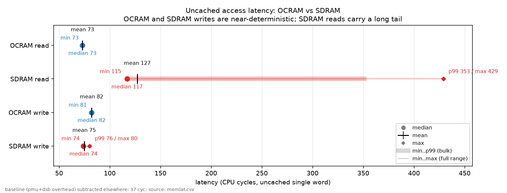
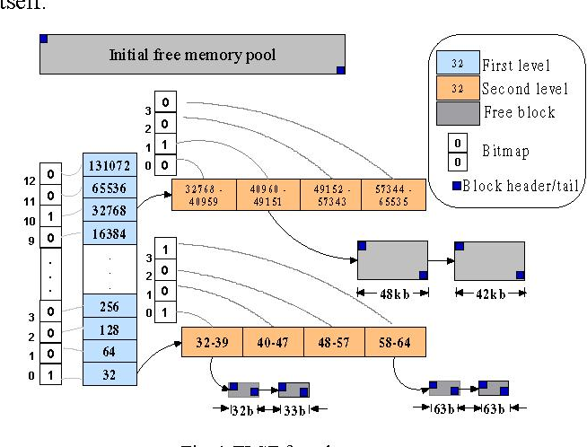
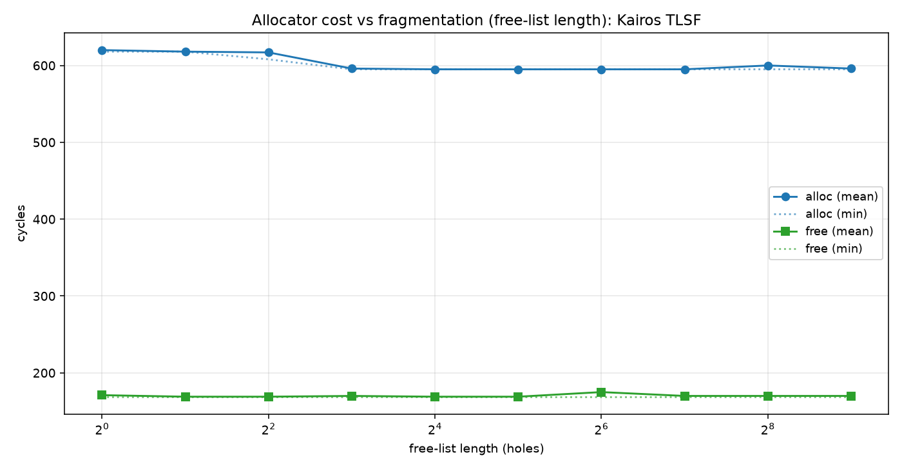
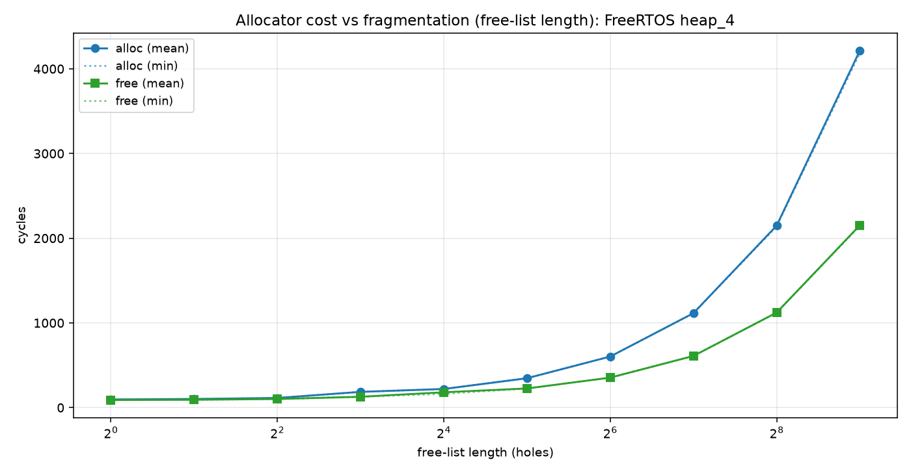
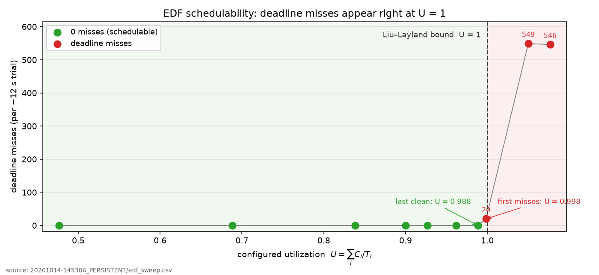
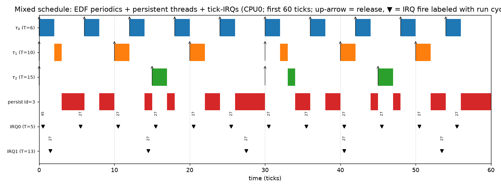
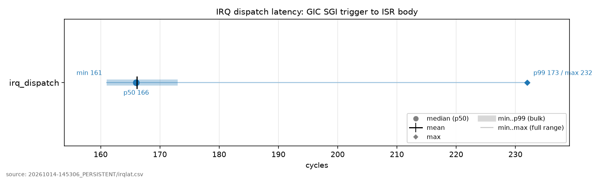
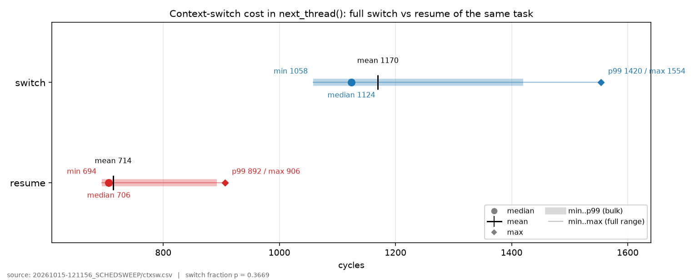
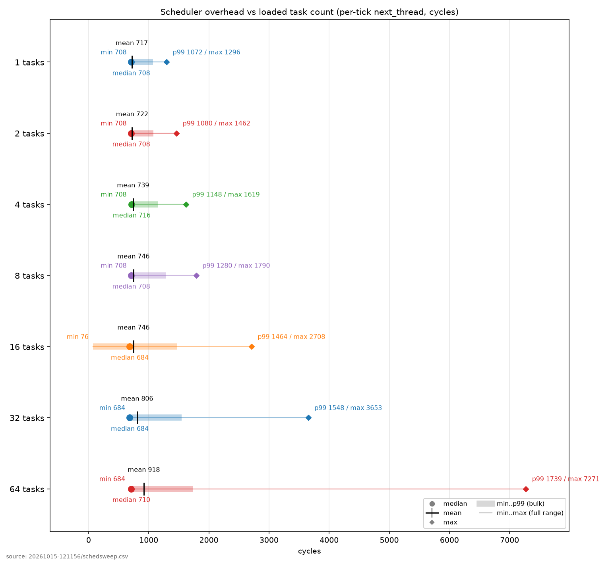
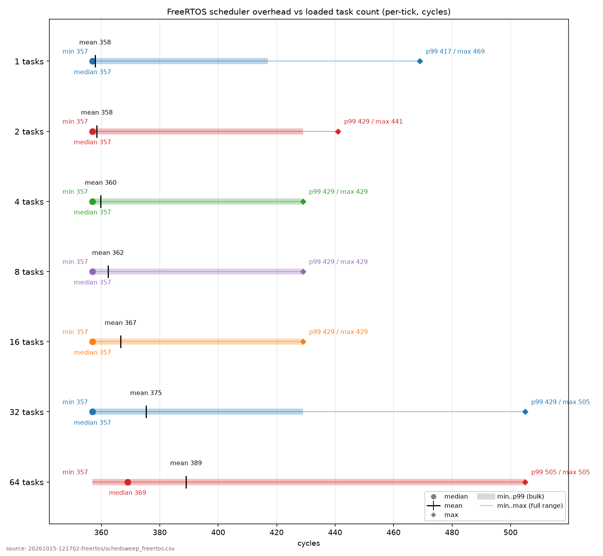

# Building an RTOS from First Principles


## Contents

1. [Introduction](#introduction)
2. [Preamble](#preamble)
3. [Types of Memory and Fused Kernel-Preloaders](#types-of-memory-and-fused-kernel-preloaders)
4. [A9 Hardware](#a9-hardware)
5. [Important Specific Numbers](#important-specific-numbers)
6. [Boot Sequence](#boot-sequence)
7. [Allocator](#allocator)
8. [Scheduler](#scheduler)
    - [Schedulability Bounds](#schedulability-bounds)
    - [Interleaved IRQ's](#interleaved-irqs)
9. [Latency](#latency)
10. [Limitations](#limitations)


## Introduction

The ARM Cortex-A9 is a relatively common microprocessor and shows up a lot as the integrated processor on smaller/older FPGA SOC's (think lower end Zynq boards, Cyclone V, etc). It's cheap, does microprocessor things reasonably well, has lots of support for interfacing with FPGA's as you'd expect, and tends to come in a nicely square-shaped package. It was also used in really old smartphones back in the day (the iPhone 4s A5 chip used two A9 cores, similar to the Cyclone V). The A9 was never designed to do real-time work though, which is ironic given its prevalence in FPGA SOC's. If one wants to do real-time work on the A9 they basically have three main solutions that can run (mostly) out of the box: 

1. Embedded Linux - Not actually real-time and very bloated depending on what is needed
2. FreeRTOS - Much leaner but not good for high utilization tasks, and its SMP support is recent and not available on every port (the A9 included)
3. Zephyr - Leaner than Linux and more capable than FreeRTOS but still somewhat bloated

It would be nice to have a very lightweight and efficient real-time scheduler. I do a lot of control and DSP stuff so EDF is a good starting point here for me because 1: it's very good for dealing with hard periodic constraints and 2: It's relatively underserved: Embedded Linux is completely inappropriate for it, FreeRTOS doesn't natively support it, and Zephyr only uses it as a tiebreaking mechanism, not as the fundamental scheduling primitive. I'd also like SMP if at all possible as all the A9-based systems I've worked with have been dual-core. Lastly, I'd like to make whatever gets built bootable such that it can be loaded onto an SD card. For now we'll ignore the FPGA stuff and assume that gets handled separately; in the future I'd like to pack the FPGA image into the SD card slot and mount it as part of the boot process but that can wait.

At the same time as all this, I'd like to answer one question: just how inappropriate is the A9 for actual real-time work? I think it's fun to try and make hardware do stuff it isn't designed to do, and I've been asked this question multiple times before to which I gave the standard safe answer of "A9 isn't designed for this so we should keep all real-time functionality on the FPGA irrespective of how fast it actually needs to run". I still think this was probably the right answer, further reinforced by the fact that we had to run Linux on the A9 in this particular situation anyway. A more conclusive answer would still be appreciated though so attempting to get it seems reasonable enough.

This project can obviously become very big very fast so an 80/20 on the core components is most likely the best use of time if not attempting to build a commercial-grade system (I don't want to maintain or sell this. I just want to see A9 do dual core EDF and pack the whole thing on an SD card).

With all that said here's the (actual) preamble.

## Preamble

We will build the thing for a Cyclone V (DE1-SOC) because that's what I currently own. Later on this may be extended to accommodate other systems as well but we'll only worry about this one for now. 

We will assume the following basic operational behaviour is expected:

1. Kernel + application code is loaded into SD card.
2. SD card goes in SD card slot.
3. The system boots from the SD card whenever it's power cycled after which it proceeds to run the application code. It's assumed the application code may make use of the kernel but it shouldn't be a requirement.
4. If a piece of hardware functionality is desired or not desired (caches, SMP etc), we pass these as compile parameters, we don't change them at runtime. 

Since we're running on a real chip we need to make sure all the hardware is initialized properly at the right times. Some of the hardware is A9-specific (GIC, L1 caches). Other stuff is Cyclone-V specific (L2 cache, SDRAM PHY). If you don't know what these are don't worry about it they will be discussed in more detail later on. The point is we need to separate the board-specific functionality so that we can port to other systems more easily in the future. This is the point of something like a board support package (BSP). Our BSP will be very minimal. Its only role will be to set up the standard Cyclone V hardware components that are shared by both cores and useful for generic system operation. The rest of the hardware initialization can be carried out by the kernel. 

### Disclaimer
This document assumes a reasonable degree of fluency with basic systems programming and computer science concepts. If basic data structures or computer architecture concepts are not yet intuitive there are tons of guides online that do a really good job at explaining them. The purpose of this guide is not "explain what an interrupt is", but rather "explain how one uses things like hardware signals, data structures, and a known initial system state to build the low-level machinery that most users take for granted when running a program". There is a lot to cover so I will try my best to focus on the most non-trivial stuff possible while leaving things like "did u know u can control piece of hardware by writing to register" as an exercise to the reader.

## Types of Memory and Fused Kernel-Preloaders

All A9's have something called On-Chip RAM (OCRAM). It's exactly what you'd expect and is 64KB on the Cyclone V. A9's also have an interface for Synchronous Dynamic RAM (SDRAM). The SDRAM lives off-chip and its implementation is up to the SOC manufacturer because memory requirements may change with the intended application. Lastly, the A9 has a special piece of memory called Boot ROM. The purpose of Boot ROM is to read data from something like an SD card and copy it into OCRAM. Then something like a preloader runs from OCRAM, initializes the SDRAM hardware, and copies the rest of the code into SDRAM. Normally the kernel would be separate from the preloader and live alongside the application code in SDRAM but there's no reason why this is strictly necessary. This means we could in theory keep small kernels in OCRAM such that the distinction between preloader and kernel effectively becomes meaningless. Since OCRAM is faster this could generally be seen as preferable, especially when extremely strict real-time requirements necessitate that caches not be used. It's also good for real-time performance, since SRAM read latency is far more deterministic than DRAM read latency, due to not having to wait for the DDR controller to give you your bits. We could also move application code into OCRAM as well if it's small enough though we do not necessarily expect that it is and so far it's been fairly restrictive to do so. This means that at the moment we will keep all appcode in SDRAM.

This is all to say we can combine the kernel with what would normally be considered a preloader and run it in OCRAM to slightly improve speed/determinism, especially when the caches are turned off. To put it into perspective, here's a speed comparison:




## A9 Hardware

As alluded to earlier, we are using a real A9 on a real SOC and so we have to worry about the physical hardware. Here's a picture:


Not pictured here is the Snoop Control Unit (SCU) which is used to manage cache coherence between both core's L1 caches and the MMU which is used for physical to virtual address translation and required for engaging the L1 data cache. For Kairos we make use of both L1 caches, the L2 cache, and the SCU.


## Important specific numbers

Here are some specific numbers which may be important in certain contexts:

- Stack Size: 8192 bytes per thread (`THREAD_STACK_SIZE = 0x2000`, embedded in each `thread_t`)
- Heap Size: 16777216 bytes (`_heap_size = 0x01000000`, carved out of SDRAM)
- Gtimer ISR Frequency (scheduler tick resolution): ~1 kHz, i.e. ~1 ms per tick. `GTIMER_AUTOINC = 199999` fires one IRQ every 200000 global-timer increments; at the MPU peripheral clock (~200 MHz, the MPU clock divided down) that lands near 1 kHz.
- L1 I-Cache Size: 32768 bytes (32 KiB, 4-way set-associative)
- L1 D-Cache Size: 32768 bytes (32 KiB, 4-way set-associative, 32-byte lines)

Every hardware block that isn't the A9 core itself sits at a fixed address in the system's address map. You talk to each one by reading and writing its registers at these addresses. These are the DE1-SoC (Cyclone V) values; the emulated QEMU board differs (its shared-peripheral region starts at `0x1E000000` instead of `0xFFFEC000`).

The shared-peripheral region (one block of hardware bolted onto the dual-core A9, base `0xFFFEC000`):
- Snoop Control Unit, keeps the two cores' L1 caches in sync: `0xFFFEC000`
- Interrupt controller, the per-core side where a core reads and acknowledges the interrupt it was handed (GIC CPU interface): `0xFFFEC100`
- Global timer, the counter whose comparator fires the scheduler tick: `0xFFFEC200`
- Interrupt controller, the shared side that decides which core each interrupt goes to (GIC distributor): `0xFFFED000`
- L2 cache controller (PL310): `0xFFFEF000`

The rest of the chip's hardware (the "HPS" peripherals):
- SD card controller, reads/writes the microSD card: `0xFF704000`
- SDRAM controller, brings up and configures the off-chip RAM: `0xFFC25000` (the register block it fills starts at `0xFFC20000`)
- Clock Manager, the PLLs and clock dividers: `0xFFD04000`
- Reset Manager, holds blocks (and the second core) in or out of reset: `0xFFD05000`
- System Manager, misc. system glue, including where the second core starts executing: `0xFFD08000`
- Scan Manager, used during SDRAM I/O calibration: `0xFFF02000`
- Watchdog timer 0, resets the chip if we stop feeding it: `0xFFD02000`
- L3 interconnect remap register, switches address `0x0` from boot ROM over to SDRAM: `0xFF800000`


## Boot Sequence

We will now do an overview of how the system boots. 

### Boot ROM to Reset Vector
All Boot ROM does is take a specific region of the SD card and move it into OCRAM, it then moves the PC to a specific address and reads a header. In the case of the Cyclone V this address is ```0x40``` and the preloader requires ```0x0C``` bytes of space allocated to the header. We populate this zone when we build the SD card image so we have to make sure no code or data lives there.

Once Boot ROM has run the header it moves the PC to the location specified in the header. We specify address 0X0 because that's where the reset vector in our vector table lives. From here we jump to ```_reset_handler``` in `kernel.s`.


### _reset_handler
The first thing we do is set the Vector Based Address Register (VBAR) to our vector table's location. 

`ldr r0, =_vectors
mcr p15, 0, r0, c12, c0, 0`

Next we walk each stack and disable interrupts. We start the walk from a different place based on which core is running:

```
.if ENABLE_SMP != 0
    mrc p15, 0, r0, c0, c0, 5        @; MPIDR
    and r0, r0, #0x3                 @; core id
    cmp r0, #0
    ldrne r0, =_cpu1_und_stack_top   @; CPU1: its own stack bank
    ldreq r0, =_cpu0_und_stack_top   @; CPU0: top-of-OCRAM bank
.else
    ldr r0, =_cpu0_und_stack_top
.endif
    msr CPSR_c, #(MODE_UND | I_BIT | F_BIT)
    mov sp, r0
    ldr r1, =_und_stack_size
    sub r0, r0, r1

    msr CPSR_c, #(MODE_ABT | I_BIT | F_BIT)
    mov sp, r0
    ldr r1, =_abt_stack_size
    sub r0, r0, r1

    msr CPSR_c, #(MODE_FIQ | I_BIT | F_BIT)
    mov sp, r0
    ldr r1, =_stack_size
    sub r0, r0, r1

    msr CPSR_c, #(MODE_IRQ | I_BIT | F_BIT)
    mov sp, r0
    ldr r1, =_stack_size
    sub r0, r0, r1

    msr CPSR_c, #(MODE_SVC | I_BIT | F_BIT)
    mov sp, r0
    ldr r1, =_stack_size
    sub r0, r0, r1

    msr CPSR_c, #(MODE_SYS | I_BIT | F_BIT)
    mov sp, r0
```


Next we invalidate the L1 I-Cache, A9 requires we do this before we can initialize it but it's easy because all we have to do is write to a register:

```
    mov r1, #0
    DSB
    mcr p15, 0, r1, c7, c5, 0
    ISB
```

L1 D-Cache is harder because there's no bulk invalidate. It's 32KB and 4-way set associative with a cache line size of 32 bytes which means there are (32 * 1024) / 32 / 4 = 256 sets with 4 mappings per set i.e. there are 256 types of 32-byte line and each line can map to 1 of 4 different locations in the cache. We will invalidate each of the 256 different sets on a per-way basis: 

```
way_loop:
    mov r3, #0
set_loop:
    mov r2, r1, lsl #30
    orr r2, r2, r3, lsl #5
    mcr p15, 0, r2, c7, c6, 2
    add r3, r3, #1
    cmp r0, r3
    BGT set_loop

    add r1, r1, #1
    cmp r1, #4
    BNE way_loop
```


We then invalidate the TLB and enable BP and data prefetch. They're on by default right now but it would be easy to make them compile options in the future. 

```
@; INVALIDATE TLB
mcr p15, 0, r1, c8, c7, 0

@; BRANCH PREDICTION ENABLE
mov r1, #0
mrc p15, 0, r1, c1, c0, 0
orr r1, r1, #(0x1<<11)
mcr p15, 0, r1, c1, c0, 0

@; ENABLE D-SIDE PREFETCH
MRC p15, 0, r1, c1, c0, 1
ORR r1, r1, #(0x1 <<2)
MCR p15, 0, r1, c1, c0, 1
DSB
ISB
```

The first time all this code is run it's on CPU0 because Boot ROM uses CPU0 by default and CPU1 is in reset state upon power cycle thus we fail the following check and enter `_cpu0_fork`:

```
_cpu0_fork:
@; Zero BSS
    ldr r0, =_bss_start
    ldr r1, =_bss_end
    mov r2, #0
bss_zero:
    cmp r0, r1
    strlt r2, [r0], #4
    blt bss_zero

@; Zero the OCRAM host island (fault records, boot gate, SMP mailbox)
    ldr r0, =_host_shared_ocram_start
    ldr r1, =_host_shared_ocram_end
    mov r2, #0
host_ocram_zero:
    cmp r0, r1
    strlt r2, [r0], #4
    blt host_ocram_zero

@; RELEASE CPU1 -> it re-enters _reset_handler and forks on MPIDR
.if ENABLE_SMP != 0
 .if BOARD_IS_QEMU != 0
    nop
 .else
    ldr r0, =SYSMGR_ROMCODE_CPU1STARTADDR
    ldr r1, =_reset_handler
    str r1, [r0]                        @; cpu1startaddr = &_reset_handler (CPU1 re-enters, forks on MPIDR)

    ldr r0, =RSTMGR_MPUMODRST
    ldr r1, [r0]
    bic r1, r1, #RSTMGR_MPUMODRST_CPU1  @; deassert CPU1 reset -> CPU1 boots ROM -> _cpu1_spin
    str r1, [r0]
 .endif
.endif
```


At this point CPU1 is engaged, branches to _reset_handler, executes all of the previous cache invalidation + BP + prefetch code and jumps to `_cpu1_fork`, wherein the code will be discussed shortly. 


After CPU0 turns on CPU1, it branches to cpu0_startup:

```
.if BOOT_TEST != 0
    bl ktrace_wait_boot
.endif
    bl cpu0_startup         @; RUN CP0 STARTUP AND SET MAILBOX
```


```C
void cpu0_startup(void)
{
#if ENABLE_SMP
    while (!g_cpu1_ready){}    /* wait for CPU1 in its spin loop before the remap below */
#endif

    bsp_sdram_init();               /* PLL/scan-mgr/SDRAM/NIC301 -- prime self-boot suspect */
    bsp_precache_init();
    build_tables();
    set_ttb_ptrs();
    cpu0_gic_init();
    cpu0_timer_start();

    pmu_init();
    heap_init();        // must precede psched_init(): it kMalloc's main_thread + the deque
    

#if ENABLE_SMP
    g_cpu_mailbox_uncached = 1;
    __asm__ volatile (
        "dsb\n\t"
        "sev\n\t"
    );

    while (g_cpu_mailbox_uncached != 2)
    {
        __asm__ volatile (
            "wfe\n\t"
        );
    }

    g_cpu_mailbox_uncached = 0;
#endif


    __asm__ volatile (
        "cpsie i\n\t"
    );

    psched_init();
}
```

`cpu0_startup` first initializes the SDRAM PHY (lots of code to do this and most of it came from [U-Boot](https://github.com/u-boot/u-boot)). To do this it needs to first start the Cyclone V PLL machinery, configure the IO ring used to physically interface with the PHY, provide inputs to the PHY's control interface, run the PHY's calibration sequence, specify the size of the memory region, and remap the system's memory so that address 0x0 starts at the bottom of the SDRAM block instead of boot ROM. From here we can enable the SCU and L2 if desired, then build our page tables. We will assume direct mapping between our virtual and physical memory. The page table allows for up to two levels of granularity. We only care about using the finer level when we want to make specific sections uncacheable, mainly for storing system diagnostic information to be read over JTAG. We set TTB pointers so we know where the page tables are, initialize CPU0's GIC and timers, start the PMU (this will be important in our scheduling policy later on), initialize the heap, and wait for CPU1 to signal that it's ready for the scheduler to be engaged (scheduler needs both cores live during SMP).  


```
_cpu1_fork:
.if ENABLE_SMP != 0
    .align 2
    ldr r0, =g_cpu1_ready
    mov r1, #1
    str r1, [r0]                        @; publish: CPU1 is off the 0x0 alias, in OCRAM
    dsb
    ldr r0, =g_cpu_mailbox_uncached

    wfe
    1:  ldr r1, [r0]
        cmp r1, #0
        bne engage
        wfe
        b 1b

    engage:
        bl cpu1_startup
        cpsie i

        ldr r0, =g_cpu_mailbox_uncached
        mov r1, #2 
        str r1, [r0]  
        dsb 
        sev

        bl cpu1_main
.endif
```


In the above C code, CP0 first signals to CPU1 that it's ready for CPU1 to run its startup routine, which sets TTB pointers, GIC, timers, and PMU like in `cpu0_startup`. It then waits for the completion signal. To save power, the wait/signal mechanism makes use of the `wfe` and `sev` instructions in conjunction with a shared mailbox to avoid breakout on the wrong event. CP0 initializes the scheduler when CPU1 has finished its startup routine. At this time, CPU1 may or may not be in its mainloop. The mainloop is empty and it's expected that when CPU1 executes tasks it does so by way of the scheduler. CPU0's mainloop is expected to contain the relevant application code and may assign tasks to CPU1 as needed. Any task running on CPU1 can also assign more tasks to the processor if desired. 


## Allocator

Kairos includes a Two-Level Segregated Fit (TLSF) allocator. The general idea is to divide free memory into a fixed number of size classes. When an allocation is requested, its size is rounded up to the smallest class that can accommodate it. The allocator then finds a free block belonging to that class or a larger one and carves out the requested memory. Any remaining memory is returned to the appropriate size class, where each block is guaranteed to be at least as large as its class's lower bound, but strictly smaller than the next class's lower bound.

The allocator is initialized with the entire heap represented as a single free block in the largest size class. To satisfy an allocation, it searches for an available block in the requested class or any larger class. Since there are at most C size classes, where C is constant, and splitting a block takes O(1) time, allocation is bounded by O(1) time.

The diagram below illustrates this process:




In more detail: there are two levels of granularity. Buckets progress as powers of 2, and bins split each bucket evenly into 32 size classes. One bitmap marks which buckets hold any free block, and a per-bucket array of bitmaps marks which bins inside it are free. Finding the first usable bucket is just locating the leading one in the bitmap; from there we compute the excess, find the first bin in that bucket big enough for the request, and scan bins and buckets upward from that minimum for the first free block.

When we carve out a block, we re-map the remainder to the largest bucket-bin pair it still fits, set the relevant bits if nothing free lived there before, and clear the old bucket/bin bits if that block was the last free one of its size. Free blocks in each class live in a doubly linked list, so with m buckets and n bins there are at most m×n active free lists.

Each free node needs at least 16 bytes: 4 for the size, 4 for the logical predecessor, 4 for the logical successor, and 4 for the previous physical block's address. That last field is what lets us coalesce backwards. Say a block of size k is freed directly in front of a free block of size s: we want to drop the s entry and make one (k+s) entry, but to check whether the block *behind* us is free we need its physical address. Coalescing forwards is free because we already know our own size. Since every free block is at least 16 bytes, the minimum allocated block is also 16 bytes: the size and previous-physical address sit in the first 8, followed by an 8-byte minimum payload, whose first 8 bytes become the next/prev pointers once the block is freed.


To put the performance advantages of TLSF into context, we compare it against a simple free-list allocator under fragmentation. The stand-in is FreeRTOS's `heap_4`. `heap_4` uses a single free list kept in address order. Every time a block is allocated, it traverses from the base to find the next free block of a viable size (O(N)). We compare worst-case bounds by allocating more and more blocks before our timed allocation to surface the worst-case runtime characteristics.






## Scheduler

Kairos uses a hybrid Earliest Deadline First (EDF) Round-Robin (RR) Scheduler. Tasks with real-time mandates go through the EDF pathway which always has priority over the RR pathway. To accomplish that we use two minheaps: the first manages released tasks by minimum deadline. The second manages unreleased tasks by minimum release time. If the global tick value for a given core is past the tasks release time, that task is considered released and runnable. This allows us to decompose each scheduler interrupt into the following steps:

1. We set a global (shared) timer during the board init. This timer has a comparator that periodically fires an IRQ signal and sets a specific register with an interrupt code. Upon IRQ signal reception provided all relevant GIC machinery is primed to accept it the A9 will move PC to a specific offset from the VBAR. Our _irq_handler lives here. We check that IRQ code matches gtimer code. If it does, then this is scheduler preemption and we invoke the appropriate routine. 

2. The scheduler routine runs from IRQ mode (`0X12`) while our task code runs in SYS mode (`0x1F`). This means that `spsr` and `lr` have the last SYS mode CPSR and PC values respectively before pre-emption occurred. We can use the `srsfd` command operating on system mode identifier `0x1F` to push the last SYS mode cpsr and pc onto the sys mode stack from IRQ mode. r0-r12 are shared across states, r13 and r14 which represent sp and lr respectively are banked. This means we need to switch to system mode before pushing anything else to the stack so we increment the right sp and we need to push r0-r12 immediately before running any interrupt code so our register state doesn't get clobbered. Note that all ARM exceptions add a fixed offset to the exception mode's lr. IRQ adds a +4 offset so that needs to be negated before we can recover the sys mode pc. 

```
    sub lr, lr, #4 @; get lr_irq i.e. get the last pre-interrupt PC value
    srsfd sp!, #0x1f @; Store Return State Full Descending --- push cpsr then pc (cached spsr then lr_irq in this case) onto sysmode stack (specified by 0x1f), sp autodecs
    
    cps #0x1f @; Change Processor State --- switch to system mode

    push {r0-r12} @; store the FULL integer register file. A context switch resumes a
                  @; DIFFERENT task, so r4-r11 (callee-saved, live across the interrupted
                  @; task's calls) must be part of the saved context -- saving only the
                  @; AAPCS caller-saved set corrupts a resumed task's r4-r11.

    push {lr} @; push lr_sys onto sysmode stack

    
    cps #0x12
```


3. Check FIFO for any tasks that haven't been added to the scheduling pool. If the task is RT release it immediately and add it to the deadline heap. If it's not RT add it to the appropriate RR-FIFO based on priority.

4. Check the release heap to see if any tasks are releasable. We will always see them the first cycle they become releasable because the ticker increments via the scheduler routine. When releasable pop from RelHeap, set deadheap to release time (current ticks) + period, and add to deadline heap. 

5. Pop first runnable task from deadline heap. This task is guaranteed to have the earliest deadline. If task is finished and aperiodic, remove it from the heap and add it to the outgoing_threads fifo. If it's finished and periodic increment its release time by 1 period and move it to RelHeap if that release time hasn't been passed yet or DeadHeap if it has. 

6. If deadheap is empty, all tasks are finished and not running again, or nothing is released yet, check the high priority fifo, then the medium priority, then the low priority one. Choose the highest priority task possible. If the same persistent task has been chosen over the other of the same priority for the same number of ticks as its period, rotate it to the back of its fifo and see if the next task is runnable. If a task is no longer runnable remove it. Repeat this process until a runnable persistent task is found or all tasks have been removed. 

7. If no task has been found by this point set the current system sp to that processor's main sp. 

8. Switch back to SYS mode and pop from sp: first restore lr and r0-r12. Then call `rfefd sp!` to restore pc and cpsr. At this point the context switch has completed.

Not mentioned above was the appropriate servicing of the GIC machinery to a. re-enable irq's when desired and b. re-enable interrupts from the gtimer source.

The tick comes from the A9 global timer. At board init (`cpu0_timer_start`) we stop the timer (`GTIMER_CTRL = 0`), clear any stale event (`GTIMER_ISR = 1`), set the auto-increment reload to `GTIMER_AUTOINC = 199999`, point the comparator one period ahead (`GTIMER_CMPL/CMPH = current count + 200000`), then write `GTIMER_CTRL = 0b1111`. The four control bits are, from the bottom: timer enable, comparator enable, IRQ enable, auto-increment. CPU1 (`cpu1_timer_start`) sets the same bits *except* the timer-enable bit — the counter is global and already running, so each core only needs its own comparator and IRQ enabled. Auto-increment is what makes re-arming free: when the comparator matches, the hardware advances it by `AUTOINC + 1` on its own, so the ISR never has to reprogram `GTIMER_CMP`.

Acknowledging a tick is therefore two levels. The asm `_irq_handler` first calls `_identify_and_clear_source`, which reads `GICC_IAR` (this acknowledges the interrupt at the GIC and returns its ID) and writes it straight back to `GICC_EOIR` (end-of-interrupt, which drops the running priority so the next tick is allowed to preempt). The ID is handed to `c_irq_handler`; for the gtimer source it writes `GTIMER_ISR = 1` to clear the event flag at the timer itself, then calls `next_thread()`. So the GIC side is serviced in `_identify_and_clear_source` and the timer side in `c_irq_handler`, and the comparator re-arms itself.


During SMP, the load balancer tracks utilization and assigns new periodic tasks to whichever core has lower utilization at that time. An EMA filter is used on the utilization calculations in order to provide a less volatile estimate. Persistent task may also be pinned to whichever core has lower utilization (as well as arbitrarily if desired) but they do not contribute to the utilization estimate themselves. The mechanics above lead to the following two important points:

1. If overall per-core utilization goes over 1.0, the system is unpredictable

2. If persistent tasks are not pinned wisely or the cores are otherwise very high-u they may be starved.

As such, it's recommended that periodic tasks be written in much the same way as periodic ISR code such that only the minimum amount of computation needed lives inside the periodic task and the period provides an ample degree of slack. For realistic workloads this is generally very doable. 


### Schedulability Bounds

Kairos' utilization tracking and load-balancing systems are [based on this paper](https://www.cis.upenn.edu/~lee/07cis505/Lec/liu73scheduling.pdf), which proves the Liu and Layland EDF Schedulability guarantee for single core processors. Math summary:

Assume $m$ independent periodic tasks, where task $i$ releases a job every $T_i$ ticks, each job needs $C_i$ ticks of compute, the deadline is the end of the period ($D_i = T_i$), and the processor is single-core. Define the **processor utilization** as the fraction of time the tasks demand:

$$U = \sum_{i=1}^{m} \frac{C_i}{T_i}$$

The paper's deadline-driven scheduling algorithm is just EDF: at any instant, run the released job whose deadline is nearest. Liu and Layland's result (their Theorem 7) is that this is an exact test:

$$\text{EDF is feasible} \iff U = \sum_{i=1}^{m} \frac{C_i}{T_i} \le 1$$

In other words the least upper bound on utilization is a full **100%**  EDF can use every spare cycle. The two directions are both easy to see over one hyperperiod $H = T_1 T_2 \cdots T_m$:

- **Necessity.** In $H$ ticks task $i$ releases $H/T_i$ jobs, so the total compute demanded is $\sum_i \frac{H}{T_i} C_i = H \cdot U$. If $U > 1$ that demand exceeds the $H$ ticks available, so *no* algorithm can meet every deadline.
- **Sufficiency.** Their Theorem 6 shows EDF never leaves the processor idle before a missed deadline (an "overflow"). So if any idle time exists, which it must when $U \le 1$, since demand $H \cdot U \le H$, there can be no overflow, and every deadline is met.


This also makes EDF **optimal**: if a task set is schedulable by any algorithm at all, it is schedulable by EDF. Contrast this with a fixed-priority scheme like rate-monotonic (where we run the next ready task with the shortest period), whose guaranteed bound (also from this paper) is only

$$U \le m\left(2^{1/m} - 1\right) \xrightarrow{m \to \infty} \ln 2 \approx 0.693$$

so RMS can be forced to miss deadlines at ~69% load (nice) while EDF is still fine. As long as a core stays at or below $U = 1$ it is provably schedulable, and the headroom $1 - U$ is the slack the round-robin persistent threads and any new periodic tasks get to run in. Note that at $U = 1$ EDF still meets every deadline, however there is zero slack here and we should avoid this state at all costs.


Intuitively: Say you have one task that takes 0.9s to run and has a 1s period. You would have 0.1s of slack to do other stuff. Now you have another task that takes 1s to run and has a 10s period. You would need 10 of those 0.1s intervals to fire inside that 10s period. Thankfully given task 1 has a 1s period you would get *exactly* 10. $$\frac{0.9}{1} + \frac{1}{10} = 0.9 + 0.1 = 1.0$$
Now say we shorten task 2's period to 9s. You can no longer fit 10 of those (0.9, 1) cycles inside the larger 9s window. We never have enough slack to finish task 2 inside those 9s so we can't say that this scheme is schedulable. 


The figures below show EDF running on real hardware at different utilizations:



The taskset runs completely clean up to $U \approx 0.99$ and only begins missing right as $U$ reaches 1. The reason it starts missing before $U=1.0$ can be explained as follows: In our previous example we showed that $U = 1.0$ for $(0.9, 1), (1, 10)$. However, this doesn't account for scheduler overhead. Real schedulers take time to run their context switches and that time eats into the slack. The real budget for task 1 might looks something more like $(0.9, 0.095, 0.05)$ where the last coordinate denotes time spent in the scheduler. There's also no guarantee this slack is constant, as it depends on the state of the EDF heaps, SDRAM access latency (thread control blocks nominally live in SDRAM which as shown above does not provide constant read latency), and possible heap operations (freeing of outgoing threads for example, these could be moved to a persistent garbage collection routine to preserve scheduler determinism if desired in the future).


### Interleaved IRQ's 
Right now we have periodic tasks and we have tasks which we set a deadline for i.e. "do by this time". And we re-release finished tasks of this type if they are periodic and the old deadline is expired. It would be nice to have a basic "when this thing happens do this thing" mechanism. We would ideally like this mechanism to be generic such that we could create new things of this type arbitrarily during runtime as needed. We would also like it to be relatively lightweight, such that there is a minimal distance between "thing happening" and "other thing being done". One way to do this is with a tick-driven interrupt mechanism wherein any given interrupt fires when the tick counter reaches some sort of deadline value. We can use min-heaps here as well so that we always know what the next upcoming interrupt is. These interrupts always take priority over EDF or RR tasks, run in IRQ mode, and are always serviced before the sys SP is changed to the next upcoming stack. They also don't have their own stacks or register state since they simply take the form of function calls in the `c_irq_handler`

We need to be careful though, because if two interrupts need to be run at the same time one will temporarily block the other. To prevent this, we make the following assumptions:
1. Interrupts mounted at arbitrary start time during runtime i.e. the first interrupt can occur whenever, it's the period we care about.
2. We design the system such that interrup frequencies are harmonics of each other
3. We assume no interrupt takes longer than a Worst-Case Execution Time (WCET) of ~4096 CPU cycles. Given the tick rate, we set the `WCET_TICKS` value to 1 (many more cycles so we're being very generous here), whcih at the moment is 1ms, more than enough time. If more resolution is desired the tick rate can be adjusted by adjusting gtimer parameters at boot. 
4. Interrupt period is defined in ticks and a zero period is invalid so that means each interrupt must have a period of at least one tick. 
5. The max number of interrupts is set to `MAX_IRQS`. Right now this constant is 100. 


```C
sys_exit_e  mount_tick_irq_to_core(irq_t* irq, cpu_core_e core, sys_exit_e (*func)(void), uint32_t period, uint32_t id)
{
    if (period == 0) return SYS_ERROR;

    irq->core = core;
    irq->func = func;
    irq->timing.period = period;
    irq->id = id;

    lock_mutex_persistent(&g_cpus[core].core_mutex);
    
    if (g_cpus[core].irqHeap->curr_index == MAX_THREADS) //Heap full = no free spots
    {
        unlock_mutex(&g_cpus[core].core_mutex);
        return SYS_ERROR;
    }

    for (size_t i = 0; i < MAX_IRQS; i++) //Should always find something
    {
        if (g_cpus[core].avail[i] == NULL) //Found free spot
        {
            if (i == 0) //First position is free 
            {
                if (g_cpus[core].irqHeap->curr_index > 0) //There must be other nonfree entries ahead of this one
                {
                    size_t j = 1;
                    while (j < MAX_IRQS)
                    {
                        if (g_cpus[core].avail[j] != NULL) break;
                        j++;
                    }
                    
                    irq_t* next = g_cpus[core].avail[j];
                    uint32_t rel = next->timing.release_time - (j * WCET_TICKS);

                    while (lt_wrapped(rel, g_cpus[core].ticks)) rel += next->timing.period;

                    irq->timing.release_time = rel;
                }

                else //no tick irqs mounted yet 
                {
                    irq->timing.release_time = g_cpus[core].ticks; //Will fire next sched preemption
                }
            }

            else //space directly behind was taken 
            {
                irq->timing.release_time = g_cpus[core].avail[i-1]->timing.release_time + WCET_TICKS;
            }

            g_cpus[core].avail[i] = irq;
            irq->md.avail_index = i;

            break;
        }
    }
    
    min_heap_insert_node(g_cpus[core].irqHeap, (void*)irq, irq->timing.release_time); 
    irq->md.status = IRQ_ARMED;

    unlock_mutex(&g_cpus[core].core_mutex);
    return SYS_OK;
}
```


When mounting an IRQ, we use an array of `MAX_IRQS`, initially empty. The first IRQ occupies the first index. Mounting another afterwards we occupy the next index and add `WCET_TICKS` to it. Whenever we mount, we always walk until we find the first free index, then set the release time to `WCET_TICKS` plus whatever the release time of the previous entry was. The one edge case is when the zeroth entry has been unmounted but there are other live entries on the array; suppose the next one is at index k, we need to preserve `k * WCET_TICKS` ticks of separation between the release times of the two entries to ensure we can greedily insert k-1 new entries between in the future if needed. To do this we can get the release time of entry k, wind it back by `k*WCET_TICKS`, and keep incrementing it by entry k's period until it is passed the deadline. At this point the release time for the new entry is both in the future relative to our current tick count `k*WCET_TICKS` **some** release of entry k. Maybe not the next release but given assumption 1 that's okay. An alternate approach could have involved taking an initial value with which to base each entry's offsets off of at the very beginning but then calculating the release time would have involved either division or repeated addition with a growing number of operations as the tick counter progresses. Both of these are undesireable. 

Below is a figure demonstrating the IRQ interleaver in conjunction with the two task families:




### Latency

Speaking of jitter, here are some figures detailing the IRQ latency and context switch cost:





The A9 runs at 800 MHz, so each cycle is 1.25 ns. The global timer runs at a quarter of the MPU clock (200 MHz), and `AUTOINC = 199999` gives one IRQ every 200000 counts, i.e. 1 kHz. We measure latency with the Performance Monitoring Unit (PMU)'s cycle counter, so every number below is a count of 1.25 ns cycles.

IRQ dispatch has a 166 cycle median (~0.21 µs), with essentially everything inside 162–175 cycles and a single worst sample over 1024 trials of 236 cycles (~0.30 µs). The context switch inside `next_thread()` either resumes the same task or starts a new one. Starting a new one can require O(log n) heap operations, so it is slower and more variable: resuming costs ~706 cycles median (~0.88 µs), switching ~1124 cycles median (~1.41 µs), tailing to 1554 cycles (~1.94 µs) in the worst case. That is for one workload (3 periodic tasks, no persistent ones); we'll see shortly that the switch cost climbs as the EDF heap fills.

For real-time work the timing variance matters more than the latency. IRQ dispatch varies by ~70 cycles (~90 ns) across its whole range, the switch by ~500 cycles (~0.6 µs), and both have short tails rather than fat ones. Against the 1 ms scheduler tick (200000 cycles) the worst-case switch is 0.8% of a tick and the worst-case IRQ dispatch is 0.12%. For periodic control/DSP work in the kHz range the per-event jitter sits three to four orders of magnitude below the deadline.

FreeRTOS on a Cortex-M quotes ~86 cycles for its context switch in its own FAQ, and independent measurements land around [~220 cycles on a Cortex-M4](https://www.researchgate.net/figure/Time-for-FreeRTOS-task-context-switching-on-STM32F407IG-ARM-Cortex-M4-for_fig2_325358846). However, a Cortex-M4 runs at ~100–180 MHz, so ~86–220 cycles is ~0.5–1.3 µs of wall-clock, comparable to our ~1.41 µs. The surprise is that we hit that on a dual-core A9 that drags caches, an MMU, and SMP coherence along while saving the full register file by hand. In absolute time we're basically even with the Cortex-M RTOS everyone benchmarks against. The one place the Cortex-M flatly wins is interrupt *entry*: its NVIC reaches the ISR in a hardware-fixed 12 cycles (~70 ns) with zero jitter, where our GIC path is ~0.21 µs with a small tail. The GIC just isn't built to guarantee fixed, low-latency entry, and there's nothing we can do about that.

The verdict: for the firm/soft real-time periodic workloads this targets, the jitter is comfortably sufficient, negligible against millisecond-scale deadlines, and competitive in absolute time with FreeRTOS on a Cortex-M. This is a genuinely surprising result for a chip supposedly unfit for real-time usage. Where it would fall short is sub-microsecond *hard* determinism, tight interrupt-to-pin response, or MHz-rate edges, where the GIC tail and cache jitter matter and a bare Cortex-M (or the FPGA fabric) is the right tool, which is exactly the work you'd want to keep off the A9 anyway. 


The Kairos EDF scheduler uses min-heaps. These incur a O(log n) worst case bound versus the O(1) bound of the simpler RR scheduler. These are worst-case bounds though, and most of the time when we preempt we aren't swithing tasks, so the average case preemption overhead is still comparable.






As we'd expect, fixed-priority is the cheaper and flatter scheduler here, roughly 2x less per tick at the baseline and a worst case that does not grow with the taskset. Kairos pays that premium for dynamic deadline ordering, the thing fixed-priority structurally cannot do, plus the dual-core balancing and the persistent class layered on top. And the premium is small against the deadline it has to clear: even Kairos's worst tick at 64 tasks is 3.6% of the 1 ms tick (200000 cycles), where FreeRTOS sits at 0.25%, so neither scheduler is anywhere near being the bottleneck for the kHz-scale periodic work this targets.

And if you only need plain round-robin scheduling, Kairos supports that too, just like FreeRTOS.


## Limitations

If it wasn't apparent by now this isn't a production-ready kernel at all. Here's a non-exhaustive list of limitations with the system:

1. It is currently only ported for the Cortex-A9 implementation on the Cyclone-V SoC
2. All real-time bounds are empirically derived, not formally verified
3. The kernel is not robust at all
4. The only synchronization primitive currently provided is a binary semaphore with a few different penalty mechanisms
5. The test code is kind of a mess
6. Nothing set up for peripherals/other timers/other processor modes atm
7. Did I mention the thing isn't robust?


We can see the worst case context switch time is noticeably less favourable to EDF, as we'd expect. We also don't currently stagger EDF tasks, so we may run into situations where many get released/terminated on the same tick. This is less than ideal, so in the future a staggering mechanism such as the IRQ interleaver to allow runtime-declared tasks to be released on different ticks may be wise. It would also be a good idea to allow creation of static tasks / tick-driven IRQ's that don't need to be created at runtime (like in most self-respecting RTOSES) such that we could stagger them as needed, but this was less exciting to build so I haven't gotten around to it yet.  

The reality is I've worked on this thing on and off for a few months now and most of the reward obtained has come firstly from implementing the kernel by hand because I'm weird and i like doing stuff like this and secondly from the joy of seeing an A9 do things that it was never advertised to do. The marginal effort to learning ratio required to go from where this project is now to something that could be mistaken for a hardened production-ready system is not worth it for me and I wanna start working on other things. As such, I've decided to release the project as-is with absolutely no guarantees of further updates. The code is available [here](https://github.com/nolanmccleary/kairos) and I would happily invite any discussions regarding test accuracy etc. The harness is kind of jank but if you have a DE1-SoC and an SD card you should be able to run everything and reproduce my results with minimal effort. 

There's also of course the obligatory AI disclaimer/limitation/whatever you want to call it. Most of the test code was written by Claude, most of the BSP code was either written by Claude or used old intel/altera/uboot code that it stitched together. Pretty much the entire kernel was written by hand but I'm sure Claude could improve it from its current state. I split things this way because I wanted to get the highest amount of learning per unit time. If I wanted to completely master Cyclone V I would do everything by hand. If I was trying to ship a product I'd probably lean on Claude more. This for me at this point in time provides a happy middle ground and I'm satisfied with the outcome.
